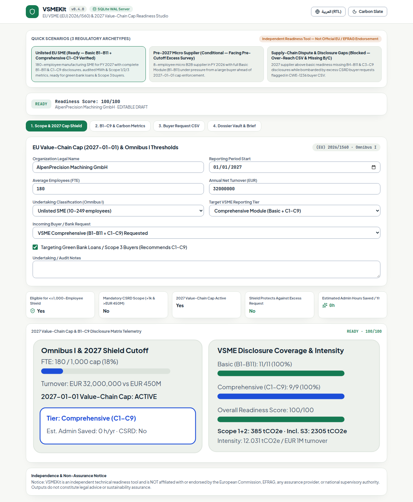
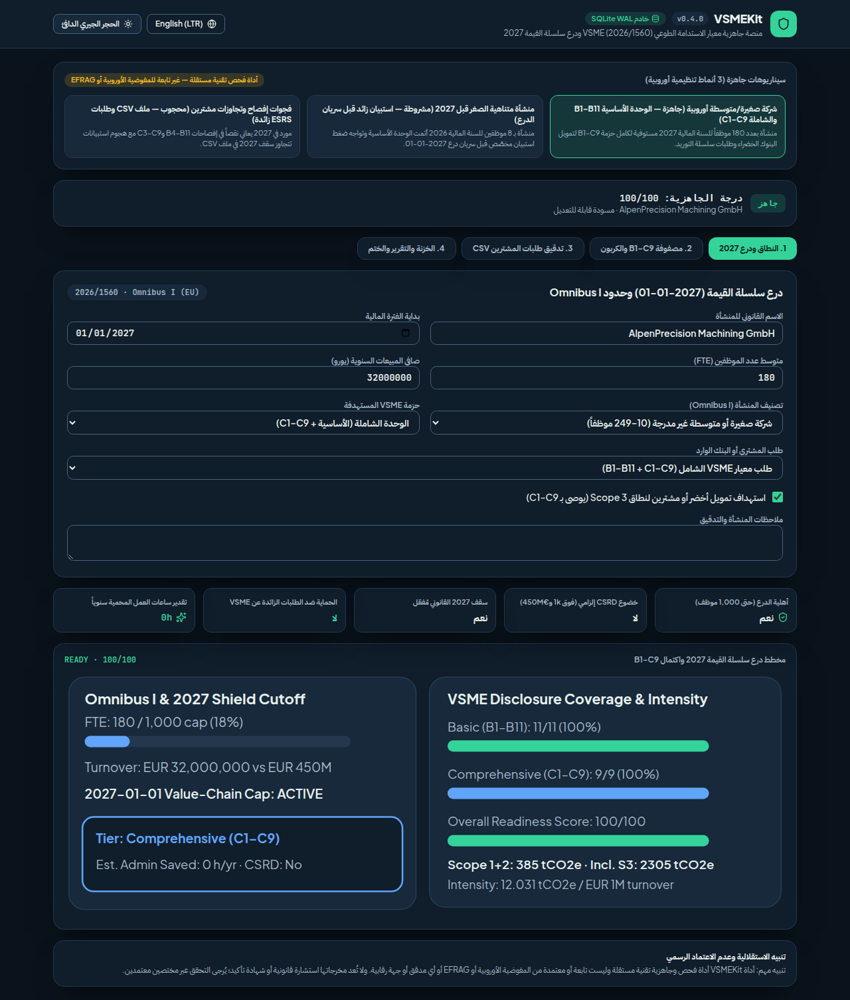
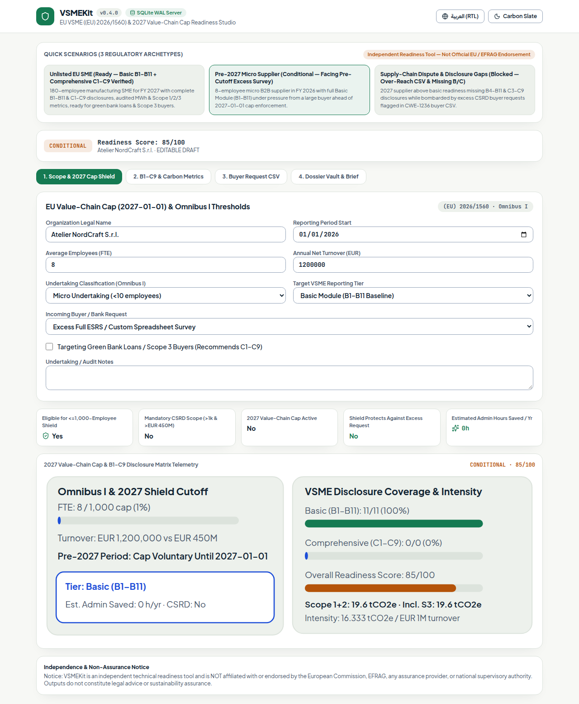
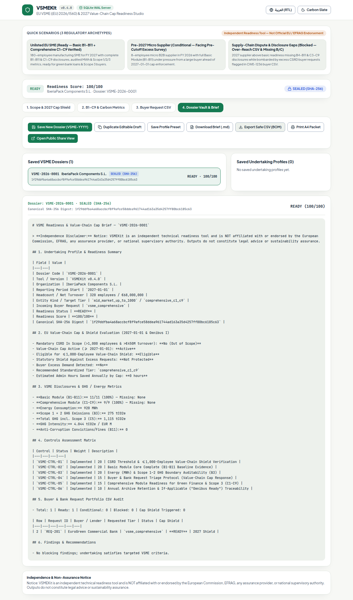
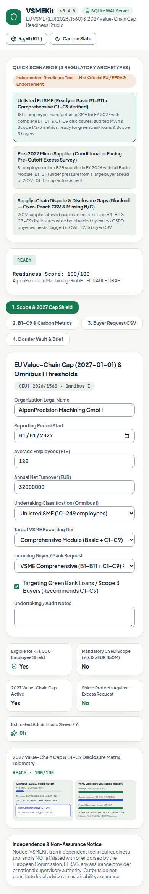
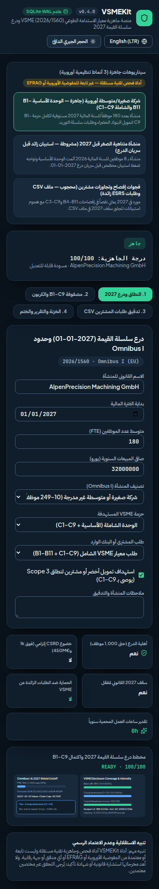

# VSMEKit — EU VSME (`(EU) 2026/1560`) & 2027 Value-Chain Cap Readiness Studio

[](LICENSE)

> **Bilingual (`EN LTR` `Limestone Parchment` Light & `AR RTL` `Carbon Slate` Dark) · Dual-Mode (`SQLite WAL` or `$0` Browser Static Mode)**

> **Mandatory Disclaimer**: VSMEKit is an independent open-source technical readiness tool and is **NOT** affiliated with or endorsed by the European Commission, EFRAG, any assurance provider, or any national supervisory authority. Outputs do not constitute legal advice or sustainability assurance.

Built with **React 19, Vite, Tailwind v4**, and an optional zero-dependency **Node 22 + `node:sqlite WAL`** backend.

---

## Regulatory Coverage (`Delegated Regulation (EU) 2026/1560` & `Omnibus I (EU) 2026/470`)
1. **Amended Mandatory CSRD Cutoff (`> 1,000` FTE & `> EUR 450M` Net Turnover)** — Evaluates whether an undertaking falls into mandatory ESRS reporting vs. voluntary SME/Mid-Cap reporting.
2. **2027 Value-Chain Cap Shield (`Effective 2027-01-01`)** — Protects `<= 1,000`-employee suppliers from excessive CSRD / custom questionnaire demands beyond EFRAG VSME limits (`estimatedHoursSavedByCap: 120 h/yr`).
3. **Basic (`B1–B11`) & Comprehensive (`C1–C9`) Disclosure Matrix** — Interactive coverage tracker across Governance, Environmental, and Social modules plus green-financing / Scope 3 tier recommendation.
4. **Energy (`MWh`), GHG Scope 1/2/3 & Carbon Intensity** — Automatic calculation of Scope 1+2 (`B3`), Scope 3 total (`C5`), and GHG intensity (`tCO2e / EUR 1M turnover`) plus `B11` anti-corruption governance check.
5. **Buyer & Bank Request CSV Triage (`CWE-1236 Safe`)** — Drag-and-drop CSV auditor neutralizing spreadsheet formula-injection prefixes (`=`, `+`, `-`, `@`, `\t`, `\r`) and exporting **`UTF-8 BOM`** (`EF BB BF`) files.

---

## Visual Showcase (`EN LTR` & `AR RTL`)

### Desktop English LTR (`Limestone Parchment` Light — Ready SME Comprehensive `100/100`)


### Desktop Arabic RTL (`Carbon Slate` Dark)


### Pre-2027 Micro Supplier Conditional Assessment (Pre-`2027-01-01` Cap)


### Remediated Portfolio CSV & Sealed `VSME-2026-0001` Dossier (`SHA-256`)


### Mobile English LTR View (`390x844`)


### Mobile Arabic RTL View (`Carbon Slate`, `390x844`)


---

## Architecture & `$0` Operation
- **Dual Mode**: Works standalone in browsers (`$0` static hosting via Cloudflare Workers Static Assets with `localStorage`) OR backed by Node 22 (`node:http` + `node:sqlite WAL`) for atomic dossier stamping (`VSME-YYYY-0001`), immutable `409` locks, bilingual `.md`/`.csv` exports, and shareable `/r/:slugOrCode` reports.
- **Canonical `SHA-256` Digest**: Deterministic dossier fingerprint (`Web Crypto` / `node:crypto`).

---

## Quick Start

```bash
npm ci
npm run typecheck
npm test        # Core & Node 22 SQLite WAL server tests (12 tests)
npm run build   # Builds static bundle into ./dist
npm start       # Serves API + React UI on http://127.0.0.1:4225
```

### Zero-Server Static Deploy (`$0` Cloudflare Workers Static Assets)
```bash
npm run build
npx wrangler deploy
```

### Playwright Chrome E2E Verification
```bash
npm run test:e2e
```

Default HTTP server binds to `127.0.0.1:4225` (configurable via `PORT`, `HOST`, `BASE_PATH`, `VSMEKIT_DATA_DIR`).
See [launch/DEPLOY-AND-SHARE.md](launch/DEPLOY-AND-SHARE.md) for `$0` Cloudflare Workers, Docker Compose, Caddy, and Systemd deployment recipes.

---

## License

Released under the [MIT License](LICENSE).
